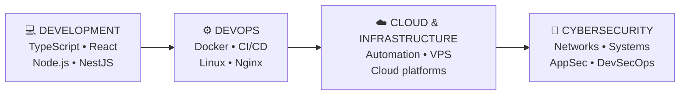

  <!-- Logo & Visitor Badge -->
  

  
      
      

    

  

<!-- Header -->

  

  

---

## 👤 About Me

Passionate about computers and new technologies from an early age, I chose
to devote myself fully to them by pursuing studies in a field that matches
my career goals.

I'm interested in understanding the complete journey of a project:

**Development → Infrastructure → Deployment → Security**

- 🔭 &nbsp;Currently working on **personal development and infrastructure projects**

- 🌱 &nbsp;Currently learning **Cloud computing, DevOps and cybersecurity**

- 👯 &nbsp;Looking to collaborate on **open-source and technical projects**

- 💬 &nbsp;Ask me about **TypeScript, Python, PHP, SQL, Bash and web development**

- ⚡ &nbsp;I learn by **building, experimenting and understanding how things work**

---

## ⚒️ TechSphere : Passion | Discovery | Exploration ⚒️

### 💻 Languages

  
  
    
  
  
  
  
  
  

### 🧩 Frameworks & Libraries

  
  
  
  
  
  
  
  

### 🗄️ Databases

  
  
  
  

### ☁️ DevOps · Cloud · Infrastructure

  
  
  
  
  
  

### 🧰 Tools

  
  
  
  
  
  
  

[Others Projects →](https://codepen.io/Monsieur9Bre99)

---
## 🚀 What I Can Do Now

### 👨‍💻 Development

- Build web applications and APIs
- Work with frontend and backend technologies
- Design and consume REST APIs
- Work with relational and NoSQL databases
- Use Git and collaborative development workflows
- Containerize applications with Docker

### ⚙️ DevOps & Infrastructure

- Work with Linux environments
- Deploy applications using Docker and Nginx
- Set up development and deployment environments
- Explore CI/CD workflows
- Manage servers and application infrastructure
- Automate repetitive tasks

### 🔐 Cybersecurity

I'm progressively developing my skills around:

- Networking
- Linux and system administration
- Application security
- Infrastructure security
- Security testing
- DevSecOps

---
## 📚 Learning Path

> **My goal is not simply to learn more technologies, but to understand how
> software, infrastructure and security work together.**

---

## 🔗 Connect With Me

  
 </a>  <!-- <a href="https://github.com/Monsieur9Bre99">   --> 

 
🐍 Contributions

 
 

📊 GitHub Stats

 

## 🏆 GitHub Achievements

  
  
  

## 🌍 Beyond Code

Technology is a big part of what I do, but not the only one.

I also enjoy:

🌱 Ecology & humanitarian initiatives  
🎵 Music  
📚 Comics & books  
🎮 Video games  
🌍 Cultures & languages  
🤝 Community & collaboration

---

 
 
 <i>From <a href="https://github.com/Monsieur9Bre99">Breroot</a></i> 
 <h3>  </h3> 

